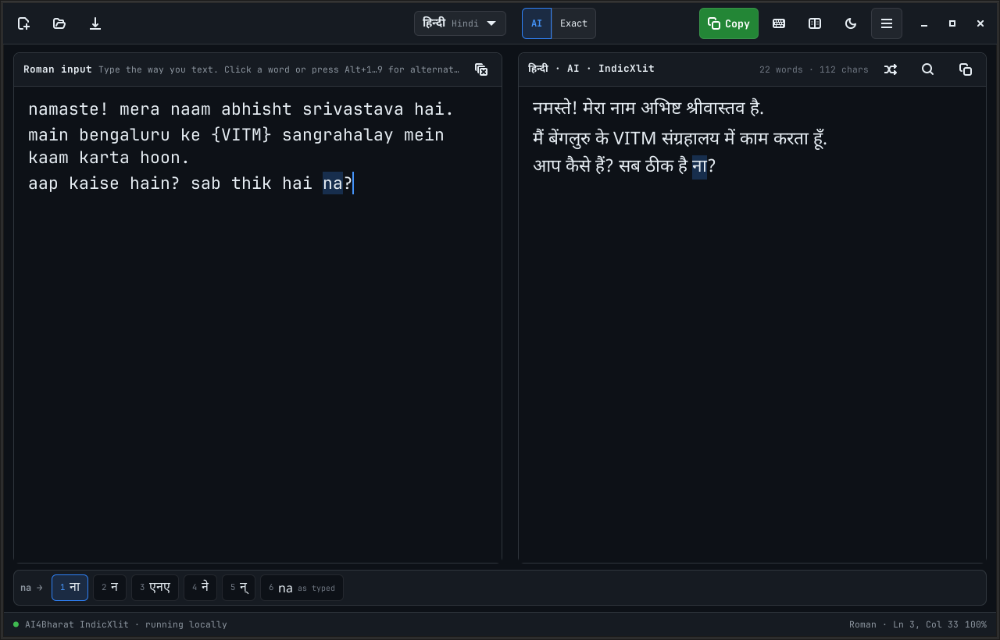
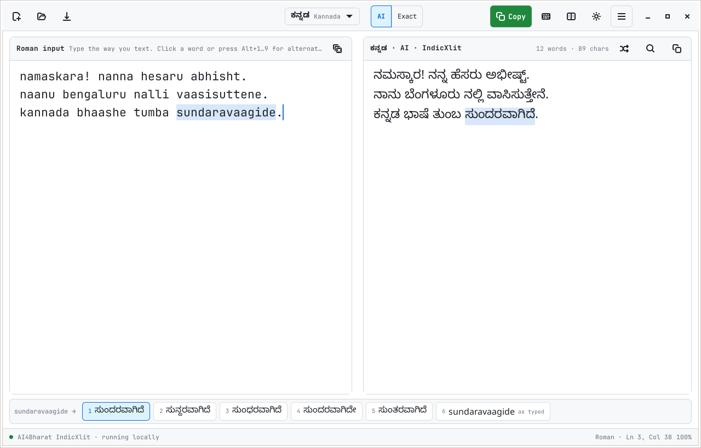
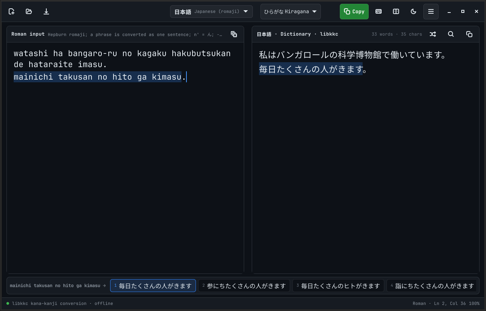
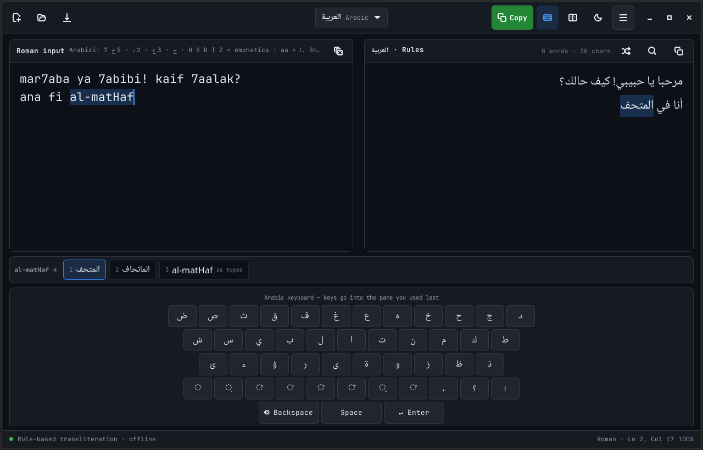

# Universal Transliterator

**Type in Roman letters, get Unicode text in 42 languages — completely offline.**

A fast two-pane editor for Linux: type on the left (`namaste, mera naam abhisht hai`),
get clean, editable Unicode on the right (`नमस्ते, मेरा नाम अभिष्ट है`). Built for
daily use — labels, notesheets, exhibit panels, messages, transcripts.



* **All 22 scheduled languages of India** with the AI4Bharat IndicXlit model running
  locally, plus an *Exact* ITRANS / IAST mode for precise spelling (great for Sanskrit).
  Casual Hindi just works: `main kahan hoon?` → मैं कहाँ हूँ?
* **Mandarin** (Rime), **Japanese** (libkkc, whole-sentence kana–kanji),
  **Korean**, **Vietnamese (Telex)**, **Arabic**, **Persian**, **Hebrew**, **Greek**,
  **Russian, Ukrainian, Belarusian, Bulgarian, Serbian, Macedonian**, **Armenian**,
  **Georgian**, **Amharic**, **Tigrinya** and **Santali (Ol Chiki)**.
* **Alternatives for every word** — click a word (or press <kbd>Alt</kbd>+<kbd>1…9</kbd>)
  and pick another spelling. Your choices are remembered.
* **Edit the output freely** — fixes you make on the right survive while you keep typing
  on the left.
* **Keep English as is** with `{braces}`; links and e-mail addresses are kept automatically.
* **Script converter** — Devanagari ⇄ Bengali, Gurmukhi, Gujarati, Odia, Tamil, Telugu,
  Kannada, Malayalam, Sinhala, and romanization to IAST, ISO 15919, ITRANS or simple Roman.
* **Never loses work** — both panes are restored on the next start; UTF-8 save, Word
  (.docx) export, find & replace, on-screen keyboards for 31 scripts.
* **Private** — no network access, no account, no telemetry, no downloads. Ever.
* **GitHub dark / light theme** with JetBrains Mono.

| Light theme | Japanese | Arabic + on-screen keyboard |
|---|---|---|
|  |  |  |

## Install

Download `Universal-Transliterator-1.2.0-x86_64.AppImage` from the
[latest release](https://github.com/asrivastava-curatorial-ws/universal-transliterator/releases/latest), then:

```bash
chmod +x Universal-Transliterator-1.2.0-x86_64.AppImage
./Universal-Transliterator-1.2.0-x86_64.AppImage
```

Or from a terminal:

```bash
wget https://github.com/asrivastava-curatorial-ws/universal-transliterator/releases/download/v1.2.0/Universal-Transliterator-1.2.0-x86_64.AppImage
wget https://github.com/asrivastava-curatorial-ws/universal-transliterator/releases/download/v1.2.0/SHA256SUMS
sha256sum -c SHA256SUMS --ignore-missing
chmod +x Universal-Transliterator-1.2.0-x86_64.AppImage
```

The AppImage is self-contained: engines, models, dictionaries and fonts are all inside.
It is built and tested on Ubuntu 24.04 x86-64 and needs glibc 2.39 or newer, so it runs
on Ubuntu/Kubuntu 24.04 and later. Other distributions of the same age should work but
are untested. If FUSE is not available, run it with `--appimage-extract-and-run`. To add
it to your application menu, use a tool such as
[Gear Lever](https://github.com/mijorus/gearlever) or AppImageLauncher, or see
[the user manual](docs/USER-MANUAL.md#desktop-integration).

## Everyday use

| Do this | How |
|---|---|
| Choose a language | <kbd>Ctrl</kbd>+<kbd>L</kbd>, type a few letters, <kbd>Enter</kbd> |
| Switch back to the previous language | <kbd>Ctrl</kbd>+<kbd>Shift</kbd>+<kbd>L</kbd> |
| Pick another spelling | click the word, then <kbd>Alt</kbd>+<kbd>1…9</kbd> or click an alternative |
| Keep a word in English | `{laptop}` or pick *as typed* from the alternatives |
| AI ⇄ exact ITRANS / IAST (Indic) | <kbd>Ctrl</kbd>+<kbd>M</kbd> |
| Copy the result | <kbd>Ctrl</kbd>+<kbd>Shift</kbd>+<kbd>C</kbd> or the green **Copy** button |
| Convert script / romanize | <kbd>Ctrl</kbd>+<kbd>Shift</kbd>+<kbd>K</kbd> |
| All shortcuts | <kbd>F1</kbd> |

Full guide: [docs/USER-MANUAL.md](docs/USER-MANUAL.md) ·
Typing schemes per language: [docs/LANGUAGE-SUPPORT.md](docs/LANGUAGE-SUPPORT.md) ·
[Known limitations](docs/KNOWN-LIMITATIONS.md) · [Changelog](CHANGELOG.md)

### Command line

The same engines work in scripts and pipelines:

```bash
universal-transliterator --to hi "mera naam abhisht hai"      # मेरा नाम अभिष्ट है
echo "vanakkam" | universal-transliterator --to ta              # வணக்கம்
universal-transliterator --to sa --exact "vasudhaiva kuTumbakam" # वसुधैव कुटुम्बकम्
universal-transliterator --list-languages
```

With the AppImage, call it as `./Universal-Transliterator-1.2.0-x86_64.AppImage --to hi …`.

## How it works

```text
Roman pane ──► tokenizer ──► engine per word ──► learned choices ──► 3-way merge ──► output pane
               ({braces},     IndicXlit (ONNX, local worker)            (keeps your
                links)        ITRANS/IAST rules · Rime · libkkc           manual edits)
                              Korean / Telex / Ge'ez / tables
```

Rust + GTK 4. The IndicXlit model runs in a private child process (Node + ONNX Runtime)
spoken to over stdin/stdout — there is no socket and no server. See
[architecture](docs/ARCHITECTURE.md), [performance](docs/PERFORMANCE.md),
[test report](docs/TEST-REPORT.md) and [security notes](docs/SECURITY-AUDIT.md).

## Build from source

On Ubuntu / Kubuntu 24.04:

```bash
sudo apt update
sudo xargs -a packaging/ubuntu-build-deps.txt apt install -y --no-install-recommends
./build_release.sh          # tests, self-test, AppImage, SBOM, checksums → dist/
```

Details: [BUILDING.md](BUILDING.md). Publishing a release: [PUBLISHING.md](PUBLISHING.md).

## Licence

Universal Transliterator is free software under the GNU GPL v3 or later
([LICENSE](LICENSE)). Bundled components keep their own licences — AI4Bharat IndicXlit
model and ONNX Runtime (MIT), Rime and libkkc data, Noto fonts and JetBrains Mono
(SIL OFL 1.1) — see [docs/THIRD-PARTY-LICENSES.md](docs/THIRD-PARTY-LICENSES.md).
